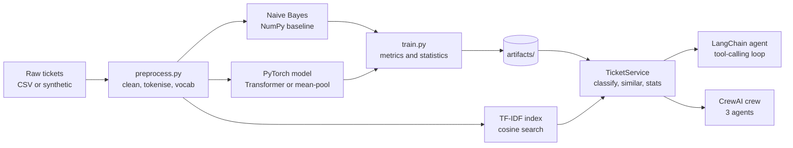

# SupportLens

**Classify customer-support tickets, find similar past tickets, and triage them with LangChain and CrewAI agents. Benchmarked honestly against a from-scratch NumPy baseline.**

  [](https://github.com/DevanshGupta7/SupportLens/actions/workflows/tests.yml) 

SupportLens takes messy, unstructured ticket text (HTML, emails, order numbers, typos), turns it into clean features, and does three things with it:

1. **Classifies** the ticket with a PyTorch Transformer, and with a Naive Bayes model written from scratch in NumPy so the two can be compared fairly.
2. **Retrieves** similar past tickets with TF-IDF and cosine similarity, also written from scratch.
3. **Triages** the ticket with an LLM agent, built twice: a hand-written **LangChain** tool-calling loop and a three-agent **CrewAI** crew.

The headline result is a useful surprise: **the simple Naive Bayes baseline beat the Transformer in all three seeds** (99.75% vs 99.20% accuracy). See [Results](#results) for what I think that means and where the evidence stops.

## Contents
[Architecture](#architecture) · [Results](#results) · [Sample agent output](#sample-agent-output) · [Quick start](#quick-start) · [Usage](#usage) · [How it works](#how-it-works) · [Testing](#testing) · [Limitations](#limitations) · [Roadmap](#roadmap) · [Project layout](#project-layout) · [Data and licence](#data-and-licence)

## Architecture



`TicketService` (in `agent.py`) holds the actual logic. Both agent frameworks are thin wrappers around it, so the framework can be swapped without touching the model or search code.

## Results

Dataset: [Bitext customer-support](#data-and-licence), 26,872 rows, of which 2,501 exact duplicates were removed, leaving **24,371 tickets in 11 categories**. Stratified 70/15/15 split (17,054 train / 3,655 validation / 3,662 test), 6 epochs on CPU. Three runs with seeds 1, 2 and 3; the seed changes both the data split and the weight initialisation.

| Model | Test accuracy (mean ± std) | Per seed | Macro-F1 (mean ± std) |
|---|---|---|---|
| Naive Bayes (NumPy, from scratch) | **99.75% ± 0.09** | 99.67 / 99.84 / 99.75 | **0.9976 ± 0.0007** |
| Transformer (130k parameters, PyTorch) | 99.20% ± 0.23 | 98.99 / 99.45 / 99.15 | 0.9915 ± 0.0024 |

- Naive Bayes was ahead of the Transformer in **every seed**, by 0.68, 0.39 and 0.60 points. In each seed a paired permutation test over the 3,662 test tickets gave p < 0.005 (p = 0.0003, 0.0046, 0.0002). Those p-values are per seed, not a combined test.
- A mean-pool ablation (embeddings averaged, no attention, 60k parameters) was run on one seed only: 98.23% against 98.91% for the Transformer on the same seed. That suggests attention helps a little, but one seed is not enough to be sure.
- Per-class F1 is at least 0.977 for every class in every seed. Errors are scattered: no confusion pair appears in the top three of more than one seed.

**What I think this means, and what I did not prove.** Bitext utterances are machine-generated from templates, so each category probably has a few strongly diagnostic words, which suits a bag-of-words model. I did not run an experiment to confirm that. A messier, human-written dataset, or the harder 27-class `--label-col intent` task, would be the test. Treat these numbers as a benchmark of this dataset, not as evidence about real-world tickets.

### Reproduce the table
```powershell
foreach ($s in 1,2,3) { python -m supportlens.train --bitext --epochs 6 --seed $s --out artifacts_s$s }
python -c "import json,statistics as s;r=[json.load(open(f'artifacts_s{i}/metrics.json')) for i in (1,2,3)];[print(k,round(100*s.mean(m[k]['acc'] for m in r),2),round(100*s.stdev(m[k]['acc'] for m in r),2)) for k in ('naive_bayes','neural')]"
```
Each run also writes per-class precision, recall and F1 plus a confusion matrix to `artifacts_s<seed>/metrics.json`.

### Evaluation method
- **Duplicates are removed before splitting**, so the same sentence can never sit in both train and test.
- **Splits are stratified**, so every class keeps its proportion in train, validation and test.
- **The vocabulary is built from the training split only**, so no test words leak in.
- **The validation set picks the best epoch** (early stopping); the test set is used once, for the final numbers.
- **Uncertainty is reported**: bootstrap confidence intervals for accuracy and a paired permutation test for model comparisons.

## Sample agent output

One run each with a Groq-hosted LLM (default `llama-3.3-70b-versatile`). LLM output varies between runs.

```text
$ python -m supportlens.agent "I never got my refund for order 123"
Category: REFUND. The ticket is about a missing refund for a specific order.
Reason: The user explicitly states they never received their refund for order 123.
Next step: Check the order's payment and refund status in the system; if the refund was not
processed, initiate the refund and inform the customer of the expected timeline.

$ python -m supportlens.crew_agent "I never got my refund for order 123"
Category: REFUND (Confidence 0.944)
Similarity check: Past tickets are labeled ACCOUNT and do not match the REFUND issue, disagreement flagged.
Next step: Verify the order's refund status in the payment system and update the customer with the resolution timeline.
```

The second output also shows a [known limitation](#limitations): similar-ticket search matched the wrong category here. The crew's last agent noticed the disagreement and flagged it instead of hiding it.

Without an API key both commands fall back to a deterministic offline router, so nothing breaks.

## Quick start

Requires Python 3.10 or newer (developed on 3.12).

**Windows (PowerShell)**
```powershell
git clone https://github.com/DevanshGupta7/SupportLens.git
cd SupportLens
python -m venv .venv
.venv\Scripts\Activate.ps1          # if blocked: Set-ExecutionPolicy -Scope Process Bypass
pip install -r requirements.txt
python -m pytest -q
```

**macOS / Linux**
```bash
git clone https://github.com/DevanshGupta7/SupportLens.git && cd SupportLens
python -m venv .venv && source .venv/bin/activate
pip install -r requirements.txt
python -m pytest -q
```

CrewAI is a heavy install. For everything except `crew_agent.py`, `pip install numpy torch langchain-core pytest` is enough, and the CrewAI test skips itself if the package is missing.

## Usage

### Train and evaluate
```powershell
python -m supportlens.train --n 3000                       # synthetic demo data, runs in seconds
python -m supportlens.train --bitext --epochs 6            # downloads Bitext (~19 MB) and trains
python -m supportlens.train --bitext --label-col intent    # the harder 27-class version
python -m supportlens.train --bitext --arch meanpool       # ablation: no attention
python -m supportlens.train --bitext --class-weights       # re-weight the loss for imbalanced classes
python -m supportlens.train --csv my.csv --text-col text --label-col label   # your own data
```
Training prints test accuracy and macro-F1 for both models, a 95% confidence interval, the permutation-test p-value, a per-class table and the most common confusions. It saves `model.pt`, `corpus.json` and `metrics.json` in `artifacts/` (change with `--out`).

### Run the agents
```powershell
python -m supportlens.agent      "I never got my refund for order 123"      # LangChain loop
python -m supportlens.crew_agent "I never got my refund for order 123"      # CrewAI crew
```
For a real LLM, get a free key at [console.groq.com](https://console.groq.com) and set it in the same terminal (never commit it):
```powershell
$env:GROQ_API_KEY = "your-key"        # macOS/Linux: export GROQ_API_KEY=your-key
```
Set `CREW_MODEL` or `GROQ_MODEL` to change the model, and `SUPPORTLENS_ARTIFACTS=<folder>` to point the agents at another training output. CrewAI may ask for a provider package on first use (`pip install "crewai[litellm]"`).

### Notebook
`notebooks/walkthrough.ipynb` walks through cleaning, TF-IDF and SVD, Naive Bayes, the Transformer, and the statistics, with a short exercise after each section.

## How it works

**Preprocessing (`preprocess.py`).** Strips HTML, replaces emails, URLs, order numbers and `{{Slot Names}}` with placeholder tokens (so the model learns "an email is present" rather than memorising addresses), lowercases, builds a vocabulary and pads to a fixed length (default 40 tokens).

**From-scratch maths (`linalg_stats.py`, NumPy only).**
- *Linear algebra:* TF-IDF, cosine similarity, and PCA through SVD.
- *Probability:* multinomial Naive Bayes with Laplace smoothing, computed in log space as a single matrix product.
- *Statistics:* accuracy, macro-F1, confusion matrix, per-class precision/recall/F1, bootstrap confidence intervals, and a paired permutation test.

**Models (`model.py`, PyTorch).** A small Transformer encoder (learned token and position embeddings, 2 layers, 4 heads, masked mean pooling) and a mean-pool baseline with no attention. Padding is masked, and an all-padding input is handled without producing NaN.

**Training (`train.py`).** AdamW, cross-entropy with optional class weights, gradient clipping, and early stopping on validation accuracy, restoring the best epoch.

**Agents (`agent.py`, `crew_agent.py`).** Three read-only tools: classify a ticket, find similar tickets, and corpus statistics.
- *LangChain:* a hand-written loop (model, tool calls, tool results, model) so every step is visible.
- *CrewAI:* a Triage Specialist (classifier), a Case Researcher (similar-ticket search) and a Support Lead with no tools, which writes the final note and must flag disagreements between the two.

**Agent safety.** All tools are read-only, only allow-listed tools can run, the LangChain loop stops after 5 steps, CrewAI agents cannot delegate and have an iteration cap, the final CrewAI agent has no tool access, tool arguments are bounded (for example, at most 5 neighbours) and tool errors go back to the model as text instead of crashing the loop. This limits what a misbehaving or manipulated model can *do*. It does not stop an LLM's wording from being influenced by a malicious ticket, so treat the output as a draft for a human.

## Testing

```powershell
python -m pytest -q                     # 26 tests
powershell -ExecutionPolicy Bypass -File .\check.ps1    # tests + training + both agents (macOS/Linux: ./check.sh)
```
The tests cover text cleaning, TF-IDF, SVD, Naive Bayes, the statistics helpers, CSV loading (blank rows, duplicates, byte-order marks, missing columns), stratified splitting, both model architectures (including padding invariance and empty input), the agent loop (unknown tools blocked, step cap, error handling), the empty-ticket path, offline fallback, and a full CrewAI run using a scripted fake LLM, so no network or API key is needed. Real-LLM behaviour was checked by hand (see the sample output) and is not part of the automated suite.

## Limitations

- **The dataset is machine-generated.** Scores are close to the ceiling and say little about real customer messages. Evaluating on human-written tickets is the most important missing piece.
- **Similar-ticket search is lexical.** Unusual phrasing can retrieve the wrong category (see the CrewAI sample). It would benefit from embedding-based retrieval.
- **40-token window.** Longer tickets are truncated before classification; the output notes when this happens.
- **No calibrated confidence.** Short, unfamiliar phrasings can get low confidence, and there is no rejection threshold yet.
- **LLM output is non-deterministic**, and the LLM modes depend on a third-party API.
- **Three seeds, one dataset, English only.** The mean-pool ablation used a single seed.
- **Not production software.** There is no authentication, and personal data is only masked for emails, URLs and order numbers.

## Roadmap

- Embedding-based retrieval and a confidence threshold that routes uncertain tickets to a human.
- A prompt-injection regression test (a ticket that tries to trigger an unlisted tool).
- Results on the 27-class `intent` label and on a human-written ticket dataset.
- Fine-tune a small pretrained model (Hugging Face, LoRA) and compare it with these baselines.

## Project layout

```text
SupportLens/
├── supportlens/
│   ├── data.py           synthetic ticket generator (demo only)
│   ├── dataset_io.py     CSV loader and Bitext download
│   ├── preprocess.py     cleaning, tokenising, vocabulary
│   ├── linalg_stats.py   TF-IDF, SVD, Naive Bayes, statistics (NumPy)
│   ├── model.py          Transformer and mean-pool classifiers
│   ├── train.py          training, evaluation, saving artifacts
│   ├── agent.py          TicketService, LangChain tools and loop
│   └── crew_agent.py     CrewAI version
├── tests/                26 tests (conftest.py shares a tiny trained model)
├── notebooks/            walkthrough.ipynb
├── docs/                 sample agent outputs
├── check.ps1 / check.sh  one-command health check
└── requirements.txt
```

## Data and licence

Code: MIT (see `LICENSE`).

Data: the [Bitext Customer Support LLM Chatbot Training Dataset](https://github.com/bitext/customer-support-llm-chatbot-training-dataset), released under CDLA-Sharing-1.0. It is downloaded on demand by `--bitext` and is **not** included in this repository; check its licence before redistributing it.

## Author

Built by Devansh Gupta, BTech CSE (AI/ML), SRM Institute of Science and Technology. [GitHub](https://github.com/DevanshGupta7)